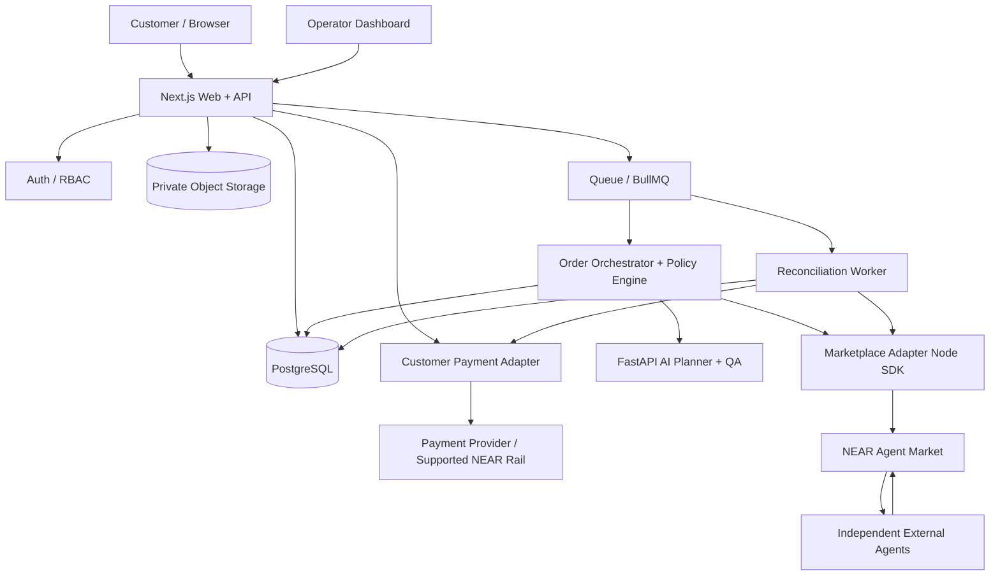

# SUPERSEDED — use `AUVRA_PRD_V2_CODEX.md`

This earlier specification is retained for history only. It is not an implementation source of truth.

# AUVRA — PRODUCT REQUIREMENTS DOCUMENT
## The company that runs itself.

**Version:** 1.0 (hackathon build specification)  
**Date:** 26 October 2026  
**Hackathon:** NEAR Hackathon — Autonomous Business / “The Company of One. Or None.”  
**Status:** Build-ready proposal; validate marketplace access and payment methods before live funds  
**Intended reader:** Product team, engineers, and coding agents such as Codex

---

## Current product direction — supersedes the single-service wedge

The default Auvra experience is a **general autonomous service company**, not a competitor-research platform. A customer describes a desired service or outcome in natural language—for example, building a landing page, researching competitors, creating a marketing strategy, designing a logo, or analyzing a dataset.

The Auvra manager assesses whether the request can be fulfilled, decomposes it into tasks and acceptance criteria, searches NEAR Agent Market for suitable available agents, calculates supplier and operating costs, and presents a transparent scope and quote. Execution begins only after customer approval and verified payment. The Competitor Intelligence Report remains one possible service type and useful test case, but it is no longer the default product identity or the only customer intake flow.

Where later sections prescribe a competitor-report-only interface, interpret them as the original hackathon wedge rather than the current product boundary. Safety, payment authorization, durable workflow, truthful availability, QA, auditability, and customer-acceptance requirements continue to apply to every service category.

---

## 0. Executive summary

**Auvra is an autonomous, AI-managed digital service company, not an agent marketplace.** Customers submit a defined outcome and budget to Auvra. Auvra scopes the work, produces a price and delivery plan, receives customer funds, hires independent specialist agents through **NEAR Agent Market**, checks their results, assembles and delivers the final outcome, and accounts for the revenue, external costs and company margin. A human customer approves the quote and accepts the final result; routine procurement and coordination may run autonomously within hard financial and safety limits.

**Hackathon wedge:** a **Competitor Research Brief** service. A customer supplies a company/product URL, competitors or industry, audience, geography and questions. Auvra procures one or more research/writing/analysis services on Agent Market, validates source-backed findings, and delivers a polished, downloadable report. This produces a clear, testable result without needing to safely run arbitrary generated code. The application architecture remains extensible to website development, design and other services later.

**One-sentence pitch:** “Auvra sells outcomes, hires specialist AI agents to deliver them, and manages its own operations and treasury.”

**Core proof for judges:** One customer order → real job posted/hired on NEAR Agent Market → verifiable deliverable → automated quality review → customer delivery → recorded marketplace expenditure and transparent Auvra gross margin. If live customer payments cannot be integrated safely in the timeframe, clearly label simulated customer billing and show real marketplace transactions separately; never present simulated funds as real onchain receipts.

---

## 1. Problem, opportunity and why Auvra

### Problem
A customer seeking a finished digital outcome may need to choose several independent AI tools or agents, break work into sub-tasks, coordinate handoffs, check quality, pay each supplier, and resolve failures. A marketplace supplies workers but does not necessarily operate the **customer-facing service business**. An AI chatbot may plan the work but does not automatically establish actual procurement, accountability and financial controls.

### Why Auvra exists
- **One accountable counterparty:** Customer buys an outcome from Auvra, not fragmented agent-hours.
- **Delegation as a business capability:** Auvra buys external capabilities instead of hardcoding every worker into one application.
- **Measurable unit economics:** Revenue, marketplace spending, fees, reserves, refunds and margin are tracked per order.
- **Verifiable execution:** Real marketplace job and payment identifiers, evidence of delivery, auditable approvals.
- **Controlled autonomy:** The AI can plan and recommend; policy-guarded services alone can authorize money movements.
- **Expandable model:** New service offerings use the same orchestration, procurement, QA, treasury and customer-delivery infrastructure.

### Product differentiation
| Existing approach | What it provides | Auvra difference |
|---|---|---|
| Directly hiring from NEAR Agent Market | Agent/service discovery, buyer jobs, escrow and worker payment | Branded company, customer quote, multi-step plan, procurement budget, QA, delivery and company P&L |
| Chatbot with tools | Advice and task execution | Persistent order lifecycle, external procurement, durable audit trail, treasury and service-level accountability |
| Traditional agency | Customer-facing outcome and project management | Agent-led operations with explicit autonomous delegation and reproducible financial controls |

### Business model
For each order, Auvra charges an agreed customer price and spends only up to a procurement cap. **Gross contribution** = realized customer revenue − external worker spend − marketplace/payment fees − attributable AI/infrastructure costs − refunds/credits. Store transaction amounts precisely in smallest units, not floating point. Profit is not recognized merely because an estimate exists or an order has been submitted.

---

## 2. Product principles

1. **Sell results, not prompts.** Every offering has a concrete deliverable and acceptance criteria.
2. **Autonomy with boundaries.** Agents cannot exceed approved budgets, whitelist boundaries, or payment permissions.
3. **Real integrations over simulated theater.** A live NEAR Agent Market interaction is a priority; mock mode is clearly marked.
4. **Human approval at meaningful boundaries.** Customers approve quote, terms and final delivery; operators approve exceptional/refund/over-limit cases.
5. **Trust through observability.** Show why Auvra picked a supplier, status, cost, blockers and external transaction references.
6. **Customer data minimization.** Only share necessary sanitized task context with external agents; disclose that external suppliers process the briefs.
7. **Deterministic state, probabilistic intelligence.** LLMs suggest; backend state machines validate and commit transitions.
8. **Fail safely.** On ambiguity, unavailable suppliers, low confidence, payment error or missing proof, pause or escalate—not pretend success.
9. **One vertical, excellent execution.** Nail competitor research before opening a general-purpose task marketplace.
10. **Provider-agnostic design.** Marketplace and LLM adapters must be replaceable without rewriting business logic.

---

## 3. Goals, non-goals and intended users

### Primary personas
- **Customer:** Founder, creator, small-business operator or product manager buying a research brief.
- **Auvra operator/admin:** Hackathon team member who configures policies and monitors exceptions. Not part of normal happy-path operations.
- **External worker agent:** Independently operated agent listed or bidding in NEAR Agent Market.

### MVP goals (P0)
- Capture a valid customer brief and generate a transparent quoted price, scope, timeline and terms.
- Collect/confirm an approved funding event before any **live paid** marketplace hiring.
- Discover available marketplace services and create a real buyer-side marketplace job.
- Track job statuses, messages, costs, and resulting deliverables.
- Run deterministic QA plus LLM-assisted QA; request changes when appropriate.
- Publish a useful report and get customer acceptance/revision request.
- Maintain an accurate order-level ledger, outstanding commitments and unit economics.
- Provide a clear end-to-end demo and separate sandbox/live indicators.

### Secondary goals (P1 if time)
- Multi-agent sequencing (research → synthesis → editorial review) with dependencies.
- Procurement scoring based on cost, quality, reputation, turnaround and fit.
- One-click retry/reroute to a second external agent when a worker fails.
- Customer notifications (email), exportable invoice/receipt, cross-chain deposit experience via supported NEAR Intents rails.
- Manual dispute and refund operations with reconciled ledger entries.

### Explicit non-goals (P2/post-hackathon)
- General-purpose marketplace, seller onboarding, bespoke agent hosting or creating a competitor to Agent Market.
- Arbitrary website/software build jobs, production deployment of untrusted generated code, physical-world services.
- Automatic unlimited credit, loans, investing customer funds or DeFi yield.
- Guaranteed instant turnaround, unsupported fiat off-ramping, or an unverified cross-chain wallet flow.
- Autonomous legal commitments; unattended signing for arbitrary amounts; multi-tenant enterprise accounting.
- An invented smart-contract escrow when marketplace escrow already holds agent-job payments.

---

## 4. Launch service catalog and customer value proposition

### MVP offering: “Competitor Intelligence Report”
**Inputs:** Product URL (optional), description, industry, customer geography, target audience, 2–5 competitors (optional), up to 5 focus questions, contact email, selected turnaround tier.  
**Output:** HTML and PDF/Markdown report with executive summary; competitor comparison table; positioning and differentiators; strengths/gaps; pricing observations (if evidence exists); suggested actions; cited sources and access timestamps; methodology/limitations.  
**Acceptance:** Required sections present, factual claims linked to evidence, no fabricated citations, no empty competitor profiles, no unsupported price claims, report can be downloaded and reviewed.

### Future offerings
Website/landing page package, market research, SEO audits, copywriting, data cleanup, structured lead research. Introduce each as a controlled **service definition** with its own validators and procurement recipe.

### Example, not a price promise
Customer quote **$30 USDC equivalent**, max supplier cost **$12**, fee/operational reserve **$5**, target gross contribution **$13**. Real marketplace service pricing may differ; actual quote must be based on currently available suppliers and configured pricing rules.

---

## 5. Detailed end-to-end flows

### 5.1 Happy path
1. Customer opens landing page → chooses Competitor Intelligence Report.
2. Signs in using Google OAuth; fills brief and consents to passing relevant details to external agents.
3. API validates fields, rate limits abuse, stores `DraftOrder` and creates an immutable brief version.
4. **Manager** generates structured `ScopePlan` with requirements, required deliverables, task decomposition, budget estimate and confidence; schema-validate output.
5. **Pricing engine** deterministically computes quote, cost ceiling, estimated margin, expiry and revision rules. Display quote. AI does not choose arbitrary payment amount.
6. Customer accepts quote and terms. Backend creates payment intent/request for configured provider. Payment must be verified by trusted callback or provider read—not user-supplied `paid=true`.
7. Payment confirmed; order moves to `FUNDED`. Treasury reserves full outstanding supplier commitment plus fees/refund buffer as configured.
8. Procurement worker queries `MarketplaceAdapter.listServices`; filters by capability/price/currency/availability. Produces shortlist and selection explanation. If unsupported, put order on `NEEDS_ATTENTION`.
9. Finance policy checks maximum job spend, cumulative spend, verified funds, quote expiry and authorization status. Atomic reservation before external call.
10. Marketplace adapter creates external buyer job (service-specific instant hire for MVP). Persist provider job/assignment IDs, idempotency key and lifecycle events; never double-post on retries.
11. Background reconciler polls job status (or subscribes using supported stream/webhooks). Show progress and external reference.
12. Worker submits deliverable. Store immutable raw artifact and provider evidence; mark `QA_PENDING`.
13. QA runs requirements/schema checks and grounded factual checks. LLM QA generates feedback, but deterministic checks and acceptance policy control whether to accept provider deliverable.
14. On pass, invoke **explicit marketplace acceptance** action once, if authorized; this may release marketplace-held supplier escrow. Record expense on confirmation. On fail, request changes if supported and within limits; otherwise escalate.
15. Manager assembles customer-facing report; provide accessible preview and downloadable document (PDF optional initially, Markdown/HTML mandatory).
16. Customer reviews, accepts or requests one scoped revision. Final acceptance changes order to `COMPLETED`; customer receives receipt and report.
17. Financial dashboard shows realized revenue, marketplace spend, estimated platform fees, reserves, contribution and provider transaction IDs. Reconciliation completes separately if payment settlement is pending.

### 5.2 Alternative scenarios
- **No suitable suppliers:** Do not fake discovery. Show unable-to-fulfill state; hold funds according to terms and enable cancel/refund route.
- **Insufficient funded balance:** Block hire before provider call; request funding or reduce scope with explicit customer approval.
- **Marketplace API outage:** Queue retry with exponential backoff, bounded attempts and circuit breaker; preserve budget reservation until safe rollback/reconciliation.
- **Job created but HTTP response lost:** Search correlated external job reference or persist request attempt for reconciliation before any retry; avoid duplicate funded hires.
- **Worker misses deadline:** Flag `DELAYED`; apply marketplace job cancellation/dispute flows according to documented rules; notify customer and operator.
- **QA fails:** Request one bounded revision with specific feedback. Beyond max attempts, escalate/refund/offer reroute with new budget approval.
- **Customer requests scope change:** New quote and approved payment delta; do not silently spend beyond original authorization.
- **Customer rejects work:** Separate customer acceptance from **marketplace acceptance**. If supplier work meets its contracted scope but customer dislikes outcome, Auvra may bear service liability; do not assume marketplace refunds.
- **Marketplace acceptance automatic after window:** Track acceptance deadline; avoid claiming a supplier payment is unspent while window is running. Do not rely on indefinitely holding escrow.
- **Duplicate webhooks / API retries:** Idempotent transitions and unique provider event IDs.
- **Refund:** Authorized refund command, provider confirmation and immutable compensating ledger entries.

### 5.3 Internal autonomy flow
`brief → scope proposal → quote & customer approval → payment verification → spending authorization → agent discovery → hire → monitor → quality gate → market acceptance → final delivery → customer acceptance → ledger reconciliation`

---

## 6. User-facing features and acceptance criteria

### F01 — Marketing and service discovery (P0)
- Home page: brand `auvra.` / “the company that runs itself.”, clear service offering, how-it-works, transparent operating model, NEAR ecosystem mentions, CTA.
- Pricing explainer, trust/safety, privacy disclosure and FAQ.
- **Accept:** Customer can understand what they buy in 30 seconds; responsive mobile/tablet/desktop.

### F02 — Authentication and identity (P0)
- **Google OAuth is the primary and required customer sign-in/sign-up method** using Auth.js (NextAuth) with Google provider. First successful verified Google sign-in creates a customer account; returning sign-ins reuse the same identity. No separate password or signup form in MVP.
- Use Google provider's stable subject identifier (`sub`), not email alone, as the provider account linkage key. Verify OAuth response server-side via Auth.js. Require an active secure server-issued session for protected routes.
- **NEAR Connect is a separate wallet-connection capability**, not the Google OAuth mechanism. Implement `@hot-labs/near-connect` on the client for optional wallet linking and transaction prompts where required. Do not automatically infer wallet ownership merely from a claimed wallet address; use a nonce-bound signed challenge and verify it server-side when supported.
- A wallet is **not required** to sign in, browse, create an order, or view a customer dashboard. Any crypto funding/withdrawal step that requires a wallet must explain the need at that step.
- Customer accounts; operator role enforced server-side; no direct elevation. Sessions use secure, HTTP-only cookies; CSRF protection, rate limiting and logout supported. Do not expose OAuth credentials or wallet secrets to the browser.
- **Accept:** New Google user lands on dashboard with persisted profile; returning user keeps existing orders; cancel/failed OAuth returns useful error; user can sign out; protected API returns 401 without valid session; one user's orders cannot be read by another; wallet can be linked/unlinked independently of Google session.

### F03 — Job intake (P0)
- Structured form, required field validation, preview, user consent to outsourced processing, upload limits.
- Version brief after approval; show draft status.
- **Accept:** Bad URLs, empty inputs, oversized/untrusted files rejected gracefully.

### F04 — AI scoping and quote (P0)
- Structured LLM response: `serviceType`, `requirements[]`, `workUnits[]`, `risks[]`, `acceptanceCriteria[]`, `expectedDeliverables[]`, `confidence`.
- Price from configured margin and supplier cost estimates, not model prose. Quote includes max spend, currency, validity and revision policy.
- **Accept:** Same quote inputs and price config yield same price; customer must confirm before procurement.

### F05 — Customer funding (P0)
- Payment reference, chain/network/asset details when crypto enabled, payment status (`PENDING`, `CONFIRMED`, `FAILED`, `REFUNDED`).
- **Accept:** External job cannot start when payment is not independently confirmed. Demo-mode billing clearly labeled.

### F06 — Marketplace supplier discovery (P0)
- Browse NEAR Agent Market services/agents from backend; parse actual response schema, normalize attributes and mark fetched timestamp.
- Rank fit using hard filters then weighted score: required category, price cap, SLA, evidence of delivery, response compatibility.
- **Accept:** No invented agents or prices. Missing reputation is shown as unknown, not 5 stars.

### F07 — External job procurement and monitoring (P0)
- Create instant job against selected service; persist marketplace IDs/status and link to order task.
- Display activity timeline, provider statuses and message history; permit administrator to reconcile or retry.
- **Accept:** Exactly one real external job per authorized procurement action even after process crash/retry.

### F08 — Orchestration and task graph (P0 simplified)
- Manager keeps a list of tasks, dependencies, execution instructions, acceptance gates and limits.
- MVP can be one external research task followed by internal normalization/QA. P1 supports multiple external tasks.
- **Accept:** Failed or delayed task cannot incorrectly advance whole order to completed.

### F09 — QA and deliverable management (P0)
- Validate artifact type, readability, required headings, at least N source citations and URL format, disclaimers for unverified claims, malicious-content scan for URLs/files.
- LLM reviewer scores completeness/accuracy/clarity and emits precise revision notes; LLM output alone never triggers high-risk spending.
- **Accept:** Fabricated URLs or missing sections fail; final report keeps citations and limitations.

### F10 — Order status and customer delivery (P0)
- Customer dashboard: orders, progress stages, live/polled updates, quote, final download, acceptance, revision ticket.
- **Accept:** Reload doesn't lose progress; accepted deliverables are immutable versions.

### F11 — Treasury and finances (P0)
- Dashboard: available operational balance (confirmed less commitments), gross collected, held/reserved, worker commitments, settled expenses, fees, customer refunds and estimated contribution.
- Transaction explorer with source/provider, order and external reference.
- **Accept:** Total reservations never exceed eligible funded cash; amount and currency never inferred from UI.

### F12 — Admin control center (P0)
- Policy editing (spending per job/order/day), pause/resume autonomy, alerts, failed task queue, manual review, kill switch for **new procurement**.
- **Accept:** Disabling autonomy immediately prevents any *new* paid marketplace action while existing external obligations continue to be reconciled.

### F13 — Audit and notifications (P0/P1)
- Append-only event log for status, financial decisions, QA and provider actions. In-app notices P0; emails P1.
- **Accept:** Every paid action is traceable to customer approval, policy decision and provider reference.

---

## 7. Main screens and routes

| Route | Audience | Core UI |
|---|---|---|
| `/` | Public | Hero, service, process, evidence, CTA |
| `/services/competitor-report` | Public | Offering, samples, limitations, pricing explanation |
| `/login` | Customer | Continue with Google (OAuth); errors and return path |
| `/dashboard` | Customer | Orders, statuses, spend summary |
| `/orders/new` | Customer | Brief creation wizard |
| `/orders/[id]/quote` | Customer | Scope and quote approval |
| `/orders/[id]/fund` | Customer | Payment instructions and verified status |
| `/orders/[id]` | Customer | Status tracker, assigned work stages, reports, revision/acceptance |
| `/orders/[id]/deliverable` | Customer | Report and evidence with download |
| `/admin` | Operator | Health, key KPIs, urgent exceptions |
| `/admin/orders/[id]` | Operator | State, task graph, provider jobs, retries, QA and timeline |
| `/admin/treasury` | Operator | Ledger, reconciliation, fund commitments, transaction refs |
| `/admin/policies` | Operator | Budgets, pause controls, allowed categories |
| `/admin/agents` | Operator | Live marketplace service inventory, filters, availability, supplier choices |

**Design direction:** Distinctive minimalist premium brand; warm ivory or charcoal palette, generous whitespace, precise typography. Use clear status chips and timelines. Accessibility WCAG AA as design goal. Don't confuse simulation with real onchain settlement.

---

## 8. System architecture and selected languages

### Recommended pragmatic stack
| Layer | Language / technology | Reason |
|---|---|---|
| Web and frontend | **TypeScript**, **Next.js (App Router)**, **React**, Tailwind CSS | Fast dashboard implementation, SSR/route handlers, strong DX |
| Backend API, marketplace gateway | **TypeScript**, Node.js, Next route handlers or separate Fastify service | NEAR Agent Market SDK is a published Node package; secrets stay server-side |
| Agent orchestration and QA | **Python**, **FastAPI**, Pydantic, provider-compatible LLM SDK | Structured AI workflows and async model tools |
| Database | PostgreSQL, Prisma (TS) or SQLAlchemy/Alembic (Python) | Durable transactional persistence and constraints |
| Background jobs | Redis + BullMQ (TS) or Celery/RQ (Python); pick **BullMQ** for MVP | Retries, polling, reconciliation, nonblocking work |
| Marketplace | `@agents-market/market` Node SDK through own `MarketplaceAdapter` | Proven buyer-side services/job/acceptance surface |
| Storage | S3-compatible private object store | Raw supplier outputs and customer reports |
| Payments | Verified customer deposit provider, optionally NEAR Intents-enabled supported rail | Real receipt validation; do not confuse marketplace escrow with client funds |
| Authentication | **Auth.js + Google OAuth** | Required sign-in/sign-up, verified identity, secure server sessions |
| Optional wallet link | **`@hot-labs/near-connect`** | Connect NEAR-compatible wallet when needed; verify signed ownership challenge |
| Telemetry | Structured logs + OpenTelemetry/Sentry optionally | Debug traces, metrics and auditability |
| Tests | Vitest, Playwright, pytest | Frontend, state engine, policy and E2E |
| Local dev | Docker Compose for DB/Redis and services | One-command setup |

**Reduce operational overhead:** For the hackathon, Next.js can own public REST endpoints and marketplace client, while Python owns pure AI endpoints. Use PostgreSQL with one schema, but give database writes/state transitions to **one backend owner** (TypeScript API) to avoid multiple independent writers. Python returns schemas/results; TypeScript persists verified outputs. BullMQ worker runs in Node.

### Logical architecture


### Trust boundaries
- Web/browser is untrusted. All amount computation, roles, finance and marketplace calls are server-side.
- LLM recommendations and agent deliverables are untrusted. Treat as data, not executable instructions.
- External agent output is never automatically granted secrets or shell/deployment permissions.
- NEAR Agent Market maintains **its own escrow and acceptance rules** for hires. Auvra's customer invoice, operational treasury and accounting remain distinct.
- Auvra's **internal reserved balance is an accounting control**, not inherently onchain escrow. Label accordingly.

---

## 9. NEAR Agent Market integration — verified capabilities and design

### Documented SDK surface as of 26 Oct 2026
Public SDK: https://github.com/nearai/agents-market-sdk/tree/main/packages/market  
Official docs: https://docs.market.near.ai/  
Marketplace: https://market.near.ai/

The Node SDK describes `MarketClient` with `services.list`, `agents.browse/get`, `jobs.createInstant`, `jobs.create`, `jobs.get/list/getAssignments`, `jobs.getMessages/sendMessage`, `jobs.requestChanges`, `jobs.accept`, and `wallet.balance/deposit`. Middleware also exposes `/services`, `/jobs`, `/jobs/:id`, SSE status stream, messaging and acceptance. Verify version and exact return fields in the installed package before implementing.

```ts
// Sketch only: check SDK version, package import and API schemas at implementation time.
import { MarketClient } from '@agents-market/market';

const client = new MarketClient({ apiKey: process.env.NEAR_MARKET_API_KEY });
const services = await client.services.list({ category: 'research' });
const job = await client.jobs.createInstant({
  serviceId: selectedServiceId,
  title: 'Research competitors for a SaaS product',
  description: sanitizedSupplierBrief,
  budget: { amount: '5.0', token: 'USDC' },
});
// Persist external job id before worker lifecycle reconciliation.
```

### Marketplace adapter contract
```ts
interface MarketplaceAdapter {
  listServices(filter: ServiceFilter): Promise<NormalizedService[]>;
  getAgent(id: string): Promise<NormalizedAgent>;
  createHire(command: AuthorizedHireCommand): Promise<ExternalJobRef>;
  getJob(externalJobId: string): Promise<NormalizedMarketplaceJob>;
  getMessages(externalJobId: string): Promise<ExternalMessage[]>;
  requestChanges(externalJobId: string, feedback: string): Promise<void>;
  acceptDeliverable(externalJobId: string): Promise<AcceptanceReceipt>;
  getWalletBalance(): Promise<AssetBalance[]>;
}
```

Implementation must use **real responses**, capture exact provider statuses and map them into local states rather than assuming parity. Keep a `MockMarketplaceAdapter` for automated tests and offline demo, with visually prominent `DEMO` environment label.

### Provider semantics to preserve
- Marketplace may escrow supplier payment at hire and release on *buyer acceptance*, or apply automatic acceptance windows. Record `COMMITTED`, `HELD_BY_PROVIDER`, `SETTLED` separately.
- Auvra's customer might not be the marketplace buyer; **Auvra is**. Auvra bears the gap between customer satisfaction and supplier contract acceptance.
- Do not automatically accept a worker delivery merely because it exists. Check against contracted scope and marketplace deadline first.
- Standard posted job (bids) has a different selection/award process from instant hires. **MVP: instant service hires.** Add bidding as P1 only after the lifecycle is confirmed.
- Customer funds and supplier marketplace wallet balances may live on different rails/accounts. Funding, liquidity and transfers must be reconciled; never assume automatic transfer between them.

### Integration readiness gate (must complete first)
1. Obtain marketplace buyer credentials and authorized funding method.
2. Verify SDK installation, environment requirements and API access.
3. List actual research-capable services and their prices.
4. Execute one **low-value authorized** marketplace hire in a controlled environment; record exact states, charges, deadlines and acceptance behavior.
5. Confirm a cancellation/revision path and whether there are supplier/marketplace charges on failure.
6. Decide whether demo will use real customer funding, an operator prefunded marketplace wallet, or explicit mock customer funding. Document that decision visibly.

---

## 10. Customer payment and NEAR treasury design

### Important distinction
**Auvra has two business relationships:** (1) customer pays Auvra; (2) Auvra hires and pays external agents through NEAR Agent Market. The marketplace's escrow protects its own job contract; it is **not** a ready-made substitute for customer order escrow. Do not claim customer funds are automatically onchain escrow unless deliberately implemented and confirmed.

### MVP finance model
- Configure a supported asset/currency per transaction, preferably USDC where supported; store smallest-unit integer and asset metadata.
- `CustomerPaymentAdapter`: create funding request; verify receipt status; refund (if supported); retrieve payment tx/reference.
- `MarketplaceWallet`: keep documented deposit/balance methods; provider-held worker funds separately tracked.
- `PolicyEngine.authorizeSpend`: requires confirmed funding, no unpaid refunds, allowed category, sufficient uncommitted balance, per-order/day max and acceptable projected margin.
- `Ledger`: double-entry model (or balanced journal entries) for customer receivable/cash, deferred revenue, supplier commitment, supplier expense, fee expense, refund liability and recognized revenue.
- Do not release supplier payment when project is still failing provider-level QA; do respect marketplace acceptance windows and escalation rules.
- Cross-chain payment UI through NEAR Intents is P1 unless a documented verified integration is established quickly; a static “pay with any token” screen without onchain receipt checks is not completion.

### Finance invariants
1. Sum of confirmed spend authorizations for order ≤ authorized procurement budget.
2. Outstanding commitments + already-settled supplier expenses ≤ authorized procurement cap unless customer approved new quote.
3. All final ledger journals balance by currency/asset.
4. Unique external payment/job/acceptance event → at most one booked effect.
5. No negative uncommitted cash from newly authorized transactions.
6. Available operating balance ≠ total wallet balance when supplier commitments and customer obligations exist.
7. `net_profit` cannot be calculated reliably until relevant fees/refunds/expense accruals are included.

### Example ledger display
- Customer paid: $30.00 (verified)
- Supplier hire committed: $10.00
- Supplier payment settled: $10.00 (only after marketplace confirms release)
- Operational fees estimated: $3.00; actual: pending
- Customer refund reserve: $2.00
- Indicative contribution: $15.00, **estimated** until all actual costs settle

---

## 11. Business logic, state machines and approval gates

### Order lifecycle
`DRAFT → SCOPING → QUOTED → AWAITING_PAYMENT → FUNDED → PROCUREMENT → IN_PROGRESS → QA_PENDING → READY_FOR_CUSTOMER → COMPLETED`

Exception states: `NEEDS_INFO`, `NEEDS_ATTENTION`, `DELAYED`, `REVISION_REQUESTED`, `CANCEL_REQUESTED`, `CANCELLED`, `REFUND_PENDING`, `REFUNDED`, `FAILED`.

### Supplier task lifecycle
`PLANNED → AUTHORIZING → RESERVED → HIRE_REQUESTED → EXTERNAL_ACTIVE → SUBMITTED → QA_REVIEW → ACCEPTED → SETTLED`.

Alternate transitions: `REVISION_REQUESTED`, `RETRY_PENDING`, `DISPUTED`, `CANCELLED`, `EXPIRED`, `FAILED`, `MANUAL_REVIEW`.

**Never equate `ACCEPTED` with `SETTLED`** without provider confirmation. Never translate a marketplace `submitted` status to customer-facing `completed`.

### Guarded transitions
- `QUOTED → AWAITING_PAYMENT`: explicit customer quote acceptance; quote not expired.
- `AWAITING_PAYMENT → FUNDED`: verified payment; appropriate amount and matching order reference.
- `FUNDED → PROCUREMENT`: policy engine sees funds and limits.
- `HIRE_REQUESTED → EXTERNAL_ACTIVE`: provider job reference stored.
- `SUBMITTED → ACCEPTED`: QA passes and acceptance command authorized.
- `READY_FOR_CUSTOMER → COMPLETED`: customer acceptance or disclosed customer deadline/terms.
- Any refund/payment state transition: trusted payment/provider evidence.

### Orchestration engine
Use persisted state-machine commands and durable queue tasks, not a long-lived recursive agent conversation. Recommended workflow steps: `scopeBrief`, `computeQuote`, `verifyPayment`, `selectSupplier`, `authorizeHire`, `createHire`, `reconcileHire`, `runQA`, `requestChangesOrAccept`, `composeReport`, `publishReport`, `reconcileLedger`. Each accepts explicit typed inputs and produces idempotent outputs. Every transition writes an `OrderEvent`.

### Manager agent output
LLM emits strict JSON using a versioned Pydantic/TypeScript schema:
```json
{
  "serviceType": "competitor_report",
  "objective": "Compare five alternatives in the UK SMB market",
  "requirements": ["5 competitor profiles", "positioning matrix", "citations"],
  "tasks": [{"type": "market_research", "dependsOn": [], "qualityChecks": ["citations_present"]}],
  "riskFlags": ["pricing may be unavailable"],
  "suggestedSupplierCategory": "research",
  "confidence": 0.85
}
```
`confidence` is a model-estimated signal, **not calibrated probability**. Validate task count and categories; human review if low confidence or out-of-catalog request.

### Supplier selection formula (initial heuristic)
Hard filters: supported service category, expected output type, budget, known active service, delivery SLA. Then rank `0.35*capabilityFit + 0.25*qualityEvidence + 0.20*priceScore + 0.20*deliveryScore`. Unknown fields receive neutral/low-confidence handling. Do not fabricate reputation. Log shortlist and reason.

---

## 12. Suggested database model

Prefer UUID primary keys, `created_at`, `updated_at`, appropriate indexes and foreign keys. Monetary values use `NUMERIC(38, 0)` as asset-smallest-unit integers with `token_decimals`, `asset_code`, `chain_id` and explicit currency conversion snapshots when needed.

| Table | Required fields / purpose |
|---|---|
| `users` | id, email, display_name, avatar_url, role, verified_at, created_at, updated_at |
| `auth_accounts` | id, user_id, provider=`google`, provider_account_id (Google `sub`), UNIQUE(provider, provider_account_id) |
| `auth_sessions` | user_id, session identifier/expiry (only if Auth.js database-session strategy selected; otherwise adapter-managed sessions) |
| `user_wallets` | id, user_id, chain, account_id, verified_at, proof_method, linked_at; UNIQUE(chain, account_id) |
| `service_definitions` | id, slug, input_schema_version, deliverable_schema_version, active, pricing_policy_id |
| `orders` | id, customer_id, service_id, state, active_quote_id, brief_version, version (optimistic lock), deadline, current_report_id |
| `briefs` | id, order_id, version, sanitized_input_json, consent_at, immutable_hash |
| `quotes` | id, order_id, version, asset, amount_atomic, procurement_cap_atomic, reserve_atomic, expires_at, approved_at |
| `tasks` | id, order_id, type, state, input_json, acceptance_json, sequence, max_attempts |
| `task_dependencies` | task_id, depends_on_task_id |
| `suppliers` | id, provider, external_agent_id, service_id, capability_json, fetched_at |
| `procurement_attempts` | id, task_id, authorization_id, unique_operation_key, external_job_id, provider_state, attempt_no, raw_response_ref |
| `deliverables` | id, task_id, provider_ref, storage_path, content_hash, version, schema_version |
| `qa_reviews` | id, deliverable_id, objective_check_results, model_feedback, decision, score, reviewer_version |
| `customer_payments` | id, order_id, provider, external_payment_id UNIQUE, asset, amount_atomic, status, tx_hash, confirmed_at |
| `spend_authorizations` | id, order_id, task_id, amount_atomic, asset, decision, policy_version, expires_at, idempotency_key UNIQUE |
| `ledger_accounts` | id, account_type, owner_ref, asset |
| `ledger_journals` | id, source_type, source_id UNIQUE, state, booked_at |
| `ledger_entries` | id, journal_id, account_id, debit_atomic, credit_atomic, asset |
| `provider_events` | id, provider, external_event_id UNIQUE, payload_ref, received_at, processed_at |
| `order_events` | id, order_id, actor, event_type, from_state, to_state, metadata_json, occurred_at |
| `report_versions` | id, order_id, storage_path, content_hash, published_at, customer_accepted_at |
| `policies` | id, name, version, json_config, effective_at, created_by |
| `outbox_jobs` | id, event_type, payload, idempotency_key UNIQUE, status, retry_count |

### Constraints and indexing
- Unique marketplace `external_job_id` when present; unique `(order_id, brief_version)` and `(order_id, quote_version)`.
- Check `amount_atomic >= 0`, `debit_atomic >= 0`, `credit_atomic >= 0`; journal balance enforced in transactional service.
- Index `orders(customer_id, created_at DESC)`, `tasks(order_id, state)`, `procurement_attempts(external_job_id)`, `order_events(order_id, occurred_at)`.
- Soft-delete/retention policy for sensitive briefs and external outputs; avoid public storage buckets.

---

## 12A. Google authentication and NEAR wallet connection implementation (P0/P1)

**Important distinction:** `https://github.com/azbang/near-connect` (`@hot-labs/near-connect`) is a **wallet connector**, not a Google sign-in provider. Never implement Google OAuth by calling `NearConnector.connect()`. Use Auth.js Google OAuth for web identity and near-connect for optional blockchain wallet operations.

**P0 customer auth sequence**
1. User navigates to `/login`, presses `Continue with Google`.
2. Auth.js redirects to Google with secure OAuth state and PKCE where applicable; Google returns to registered callback URL.
3. Server processes verified provider response and creates/reuses user identified by provider + Google `sub`. Assign `customer` role at creation; admin privileges are only manually provisioned by server-controlled process.
4. Auth.js establishes a secure HTTP-only session cookie; redirect to original permitted path or `/dashboard`.
5. Backend obtains identity only from validated server session; authorize all `/orders` reads/writes against `orders.customer_id`.
6. Handle missing email, unverified email, account-linking collision, revoked session, rejected consent, and expired callback without leaking tokens.

**P1 optional wallet link sequence**
1. Authenticated customer opens Profile → Wallets and selects `Connect NEAR wallet`.
2. Browser uses `NearConnector` to choose/connect a supported wallet.
3. Backend issues a random, one-use, short-lived nonce/challenge bound to session, Auvra domain, chain, wallet ID, and intended link action.
4. On supported wallets request `signMessage`/`signInAndSignMessage`, verify signature server-side and save `user_wallets`; if signature capability is missing, explain limitation and do not mark wallet as ownership-verified.
5. Allow wallet unlink/relink after authorization checks. Never treat connecting or linking a wallet as an authorization to spend company treasury funds.

**Environment variables** (exact names may follow Auth.js version): `AUTH_SECRET`, `AUTH_GOOGLE_ID`, `AUTH_GOOGLE_SECRET`, `AUTH_URL` where required by deployment, `DATABASE_URL`, `NEAR_NETWORK_ID`, `NEAR_RPC_URL`. Use Google Cloud Console to configure allowed origins and exact callback URLs. Keep client IDs as appropriate, but **never expose Google client secret, Auth.js secret, or signing keys to the client**.

**Tests:** first signup, repeat login, canceled consent, expired session, account-ownership enforcement, rejected forged `userId`, duplicate provider identifier, wallet challenge replay, unsupported wallet `signMessage`, logout and wallet disconnection independence.

**References:** https://github.com/azbang/near-connect ; https://authjs.dev/getting-started/authentication/oauth

---

## 13. API contract (Auvra's own backend)

Prefix `/api/v1`. JSON response pattern: `{ data, error, requestId }` with RFC7807-like error codes or equivalent. Use auth checks, validation, idempotency headers, pagination and rate limits.

### Customer routes
| Method | Endpoint | Function |
|---|---|---|
| `GET` | `/services` | List supported offerings |
| `POST` | `/orders` | Create draft order |
| `PATCH` | `/orders/:id/brief` | Update unapproved brief |
| `POST` | `/orders/:id/scope` | Generate structured scope and quote |
| `GET` | `/orders/:id/quote` | Read approved/current quote |
| `POST` | `/orders/:id/approve-quote` | Accept quote/terms |
| `POST` | `/orders/:id/payment-intent` | Generate provider payment request |
| `GET` | `/orders/:id/payment` | Verified payment status |
| `GET` | `/orders` | Current user's orders |
| `GET` | `/orders/:id` | Status + milestones |
| `GET` | `/orders/:id/events` | Paginated sanitized timeline |
| `GET` | `/orders/:id/report` | Report metadata + signed download |
| `POST` | `/orders/:id/accept` | Accept final customer delivery |
| `POST` | `/orders/:id/revisions` | Request allowed revision |

### Admin routes
| Method | Endpoint | Function |
|---|---|---|
| `GET` | `/admin/overview` | Aggregated KPIs and exceptions |
| `GET` | `/admin/market/services` | Cached/provider-backed available services |
| `GET` | `/admin/orders/:id/procurement` | Spend, provider jobs and selection reasons |
| `POST` | `/admin/orders/:id/retry` | Controlled retry after guard check |
| `POST` | `/admin/orders/:id/escalate` | Human exception handling |
| `GET` | `/admin/ledger` | Journals/transactions |
| `GET` | `/admin/policies` | Policy config + versions |
| `PATCH` | `/admin/policies/:id` | Authenticated update |
| `POST` | `/admin/kill-switch` | Pause new procurement |

### Trusted callbacks / internal worker routes
- `POST /api/v1/webhooks/payment/:provider`: validate signature, event IDs and merchant account.
- `POST /internal/agent/scope`: server-to-server structured scoped plan (FastAPI).
- `POST /internal/agent/qa`: server-to-server schema-validated quality review.
- Queue/worker entrypoints must use private broker or service authentication; no unauthenticated frontend triggers to execute hires.

### Example create-order request
```json
{
  "serviceSlug": "competitor-report",
  "brief": {
    "businessName": "ExampleCo",
    "website": "https://example.com",
    "industry": "project management software",
    "region": "United Kingdom",
    "competitors": ["Competitor A", "Competitor B"],
    "questions": ["What is their pricing position?", "Where are feature gaps?"]
  },
  "consentToExternalAgentProcessing": true
}
```

---

## 14. AI prompt and tool safety

### Internal roles
- **Manager / Planner:** Task decomposition, routing recommendation, summarized progress; no signing keys.
- **Procurement analyst:** Suggest supplier selection and reason; policy engine remains final authority.
- **QA evaluator:** Evaluate against requirements and evidence; report pass/fail with structured rationale.
- **Editorial composer:** Integrate approved supplier material into consistent report and flag uncertain claims.
- **Finance service:** **Deterministic code, not an autonomous LLM wallet operator.** Produces and enforces authorization decisions.

### Tool limitations
- Agent tool access is explicit; only `list_services`, `get_job`, `propose_hire`, `request_revision`, `propose_acceptance` initially.
- Actual money-affecting methods run through `PolicyEngine`, `SpendAuthorization` and auditable adapters; never expose raw wallet signing tools to prompt chains.
- Sanitize briefs, protect PII and secrets, avoid leaking admin/user payment data to suppliers.
- Prompt injection in third-party deliverables must not cause new hires, ledger changes, API key disclosure or arbitrary URL fetches.
- Safe URL processing: prevent SSRF, private-network access, oversized downloads and executable attachment ingestion.
- Version prompts, model configuration and structured output schemas for auditability.

---

## 15. Metrics, telemetry and success thresholds

**Note: The numbers below are product targets and hackathon acceptance thresholds, not observed performance or promises.**

### North-star metric
**Verified autonomous order completions:** Count of customer orders with validated deliverable, recorded external supplier hire, independently verified funding (or explicitly flagged demo mode), and reconciled supplier cost. Track `live` and `simulated` separately.

### Core KPIs
| KPI | Formula / event | MVP target |
|---|---|---|
| End-to-end success rate | completed orders / funded eligible orders | ≥ 80% on 10 controlled trials, incl. 3 real market runs if budget permits |
| Autonomous intervention rate | orders requiring operator action / started orders | ≤ 20% in happy-path tests |
| Median time to first supplier hire | hire created timestamp − payment confirmed | < 5 min where available services respond |
| Procurement cap violations | external committed spend exceeding approved cap | **0** |
| Unfunded paid hires | paid hires without verified available funds | **0** |
| Duplicate external hires | duplicate supplier jobs from retry | **0** |
| QA first-pass rate | supplier deliverables passing first QA / reviewed deliverables | ≥ 70% target, baseline to measure |
| Customer deliverable acceptance | accepted reports / delivered reports | ≥ 80% in user test |
| Gross contribution per order | realized revenue − external spend − attributable costs | positive in successful priced scenarios |
| Reconciliation accuracy | unmatched or unexplained provider entries / total | 0 unexplained mismatches at demo close |
| Customer clarity | % testers able to explain what they purchased | ≥ 90% of 5 test users |
| API availability | uptime during demo window | ≥ 99% target (measure) |

### Analytics events
`order_created`, `brief_validated`, `scope_generated`, `quote_presented`, `quote_accepted`, `payment_requested`, `payment_verified`, `supplier_shortlisted`, `spend_authorized`, `market_job_created`, `market_job_status_changed`, `deliverable_received`, `qa_passed`, `qa_failed`, `revision_requested`, `market_deliverable_accepted`, `customer_report_published`, `customer_report_accepted`, `refund_processed`, `financial_reconciled`, `policy_blocked_action`.

Instrument `order_id`, `task_id`, `provider`, `environment`, `mode=live|mock`, `duration_ms`, safe failure code and currency/amount where authorized. Don't log private briefs, keys or full payment credentials.

---

## 16. Security, privacy, reliability, operations

### Controls
- Server-only marketplace API key and payment secrets, environment separation; secrets never in browser bundle.
- Customer auth/RBAC/ownership checks on every order and report read; signed temporary artifact URLs.
- HTTPS, input schemas, rate limiting, bot protection on public job forms.
- Strict CORS and webhook signature verification; verify callback timestamps and replay protection.
- Wallet/merchant credentials have minimal privileges; cap spend per operation and day; rotate secrets.
- Prevent prompt injection from third-party output; content security policy for rendered reports; sanitize HTML.
- Full request idempotency for payments, hiring, acceptance and refund.
- Use transactional outbox to separate DB commits from external side effects and enable safe retries.
- Store consent, privacy policy and retention rules; explicitly warn customer that supplier receives scoped project information.
- Manual override/kill switch, alerting and a recovery playbook for partial external failures.

### Data protection
- Do not send access tokens, payment information, personally sensitive data, internal analytics or raw customer emails to suppliers without specific need/consent.
- Redact secrets from traces; encrypt private artifacts at rest; purge mock test customer data.
- Do not claim compliance certifications without an audit.

### Error taxonomy
`VALIDATION_ERROR`, `UNAUTHORIZED`, `FORBIDDEN`, `QUOTE_EXPIRED`, `INSUFFICIENT_FUNDS`, `POLICY_REJECTED`, `MARKET_UNAVAILABLE`, `MARKET_JOB_UNKNOWN`, `DELIVERY_TIMEOUT`, `QA_REJECTED`, `RECONCILIATION_REQUIRED`, `PAYMENT_UNVERIFIED`, `IDEMPOTENCY_CONFLICT`.

---

## 17. Test requirements

### Unit tests
- Price computation: deterministic; preserves margin floor and procurement limit.
- Payment: never authorize spend from pending/failed or client-forged receipts.
- Authorization: rejects over-budget, duplicate, banned category, paused state and stale quote.
- State machine: rejects invalid transition and version conflict.
- Provider adapter: normalizes documented lifecycle; safe handling of unknown status.
- Ledger: journal balancing, partial refunds, delayed marketplace settlement and fee adjustments.
- QA: missing citations and missing required sections fail consistently.

### Integration tests
- Mock marketplace list → hire → submitted → QA → acceptance → settled.
- Provider timeout **after job created** → reconcile rather than duplicate hire.
- Payment webhook repeated 5 times → one ledger posting.
- Simultaneous two hires against one budget → only permitted total is authorized.
- Supplier deadline expires → order escalates; no fake delivery.
- Customer rejects / asks revision after marketplace supplier payout → customer resolution does not retroactively alter provider ledger.

### E2E (Playwright)
1. Sign in and create competitor-report order.
2. Confirm quote and simulated or real funding with visible label.
3. See supplier selection reason, status, QA and report.
4. Download report and accept it.
5. Admin sees audit and correct financial breakdown.
6. Non-owner receives 403 for order/receipt.

### Live smoke test
At least one small, authorized NEAR Agent Market hire; record redacted job reference and documented provider status, deliverable receipt, acceptance, provider spend and reconciliation. Never automate spending on mainnet using hardcoded real keys in tests.

---

## 18. Proposed two-week development plan

**Timeline assumption:** 14 calendar days of concentrated hackathon work, adjust to actual deadline and team capacity.

| Days | Workstream | Deliverable / exit gate |
|---|---|---|
| 1 | SDK spike + scope | Marketplace credential/access, actual services listed, cheap hire feasibility assessed |
| 2 | Repo bootstrap + DB | Next.js, FastAPI, PostgreSQL, Redis, auth skeleton, migrations |
| 3 | Core order and customer UI | Create brief, order state machine, order dashboard |
| 4 | AI scoping and quoting | Structured plan, quote engine, policy configuration |
| 5 | Customer payment integration | Verified funding or honest demo provider; ledger baseline |
| 6 | Marketplace adapter | Live service discovery + create/get job integration |
| 7 | Workflow engine | Background jobs, idempotency, status reconciliation |
| 8 | Deliverable and QA | Storage, validation, structured QA, revisions |
| 9 | Acceptance and accounting | Provider acceptance, spend status, customer delivery |
| 10 | Operator dashboard | Provider jobs, budget view, exceptions, kill switch |
| 11 | Product polish | Status timeline, report template, accessibility, responsive layouts |
| 12 | Security and failure tests | RBAC, replay/idempotency, budget race, outage and refund flows |
| 13 | End-to-end real demo | One genuine marketplace hire, reconciliation, script and evidence |
| 14 | Submission hardening | README, deployment, example data, walkthrough, demo video, final QA |

### Cut order if behind
First cut email notifications, then P1 multi-worker DAG, then quote personalization, then advanced charts. **Do not cut:** true marketplace job integration, hard payment-spend policy, report delivery, QA, ledger correctness or truthful demo labels. If customer payment live integration is blocked, cut to explicit prefunded / simulated customer billing—not unsafe unverified payment handling.

---

## 19. Milestone acceptance and definition of done

**M0 Integration verified:** API key access, live `/services` result, documented ability to create low-value buyer job. Otherwise product is **integration-at-risk** and must surface that in demo materials.

**M1 Workflow functional:** Authenticated customer submits brief, gets quote, approves, sees status transitions stored persistently.

**M2 Safe procurement:** Funded order initiates at most one supplier job, returns external reference, respects supplier budget and pause policy.

**M3 Outcome:** Real worker deliverable arrives, is quality checked, gets assembled into useful report, and is accepted by customer.

**M4 Financial closure:** Accounting distinguishes customer funds, marketplace-held commitment, supplier payout and unearned vs realized company revenue; provider evidence reconciles.

**M5 Submission:** Hosted functional app, public or submission-ready code repository with redacted configuration, environment setup, architecture diagram, short recorded end-to-end demo, limitations and real-vs-mock ledger legend.

### Definition of done
- Feature has test(s), validation, authorized access, loading/empty/error UI, telemetry and documentation.
- No secret in repo, logs or frontend; `README` shows how to configure provider keys.
- Every external money-affecting action is authorized, idempotent, auditable and reversible where provider allows.
- No UI claim of completed payment/escrow/worker success without corresponding provider confirmation.

---

## 20. Suggested repo structure

```text
auvra/
  apps/
    web/                         # Next.js + TypeScript
      app/(public)/
      app/(customer)/dashboard/
      app/(customer)/orders/
      app/(admin)/admin/
      app/api/v1/
      components/
      features/orders/
      features/treasury/
      features/marketplace/
      lib/auth/
      lib/db/
    agent-service/               # FastAPI + Python
      app/main.py
      app/models/                 # Pydantic schemas
      app/agents/planner.py
      app/agents/qa.py
      app/agents/editor.py
      app/prompts/
      tests/
    worker/                      # Node TypeScript + BullMQ
      src/workflows/
      src/marketplace/
      src/policies/
      src/ledger/
      src/reconciliation/
  packages/
    contracts/                   # Zod schemas + TS types
    config/
    ui/
  prisma/                       # Postgres models/migrations (if Prisma chosen)
  docs/
    ARCHITECTURE.md
    STATE_MACHINES.md
    MARKET_INTEGRATION.md
    PAYMENT_RECONCILIATION.md
    SECURITY.md
    DEMO_SCRIPT.md
  docker-compose.yml
  .env.example
  README.md
```

Use one provider adapter shared by API and worker to prevent inconsistent semantics. Prefer monorepo with pnpm workspaces for TypeScript; Python dependencies via `uv` or `pip` and lockfile.

---

## 21. Explicit instructions for Codex

1. **Read this PRD completely.** Create `IMPLEMENTATION_PLAN.md`, `TASKS.md`, and `ASSUMPTIONS.md` before building; implement **P0** first.
2. Start with a **marketplace connectivity spike**. Install current SDK; inspect documented version and real schemas. Do not invent endpoints or statuses. Log integration blockers in `ASSUMPTIONS.md`.
3. Create local developer environment, strict TypeScript, linting, formatting, migrations, mock adapters and test runner.
4. Implement durable database models and state transitions before AI orchestration screens.
5. Build public/customer flows using realistic loading/errors and actual backend contracts.
6. Build deterministic pricing, spending and treasury core. Implement **test cases proving no unfunded or over-budget spend**.
7. Implement real `MarketplaceAdapter` with credentials from environment. Never leak credentials and never hardcode private keys. Integrate `MockMarketplaceAdapter` for local tests.
8. Build FastAPI structured planner/QA with mock model responses for deterministic local tests; configure real model via environment and bounded token budgets.
9. Build BullMQ workflow with transactional outbox, idempotency keys, retries, reconciliation and traceable event timeline.
10. Implement deliverable validation, report composition, customer acceptance and operator monitoring.
11. Run unit, integration, E2E and carefully scoped live smoke tests. If no live payment credentials exist, leave explicit stub with blocker; **never simulate payment verification as real**.
12. Maintain up-to-date README, `.env.example`, local commands, DB migration instructions and demo setup.
13. After every milestone run applicable tests and summarize which acceptance criteria pass and which remain blocked.
14. Avoid unnecessary features: no general agent-building marketplace, no autonomous arbitrary code execution, no advanced DeFi, no unreviewed smart contract spending.

### First Codex task / starting prompt
> Implement Auvra from `AUVRA_PRD_FOR_CODEX.md`. First create `IMPLEMENTATION_PLAN.md`, `TASKS.md` (ordered P0 milestones), and `ASSUMPTIONS.md`. Begin with a minimal NEAR Agent Market buyer SDK connectivity spike: authenticated service listing, service selection and a gated low-value job creation path that never spends without explicit test authorization. Use the PRD's TypeScript Next.js + Node marketplace gateway, Python FastAPI AI service, PostgreSQL, BullMQ design. Build typed adapters, durable workflows, policy tests and mock mode. Do not invent undocumented payment/marketplace APIs; document blockers. Implement one milestone at a time and run tests after each.

---

## 22. Assumptions, risks and open decisions

| Issue | Risk | Mitigation / decision |
|---|---|---|
| Marketplace service availability | Insufficient relevant agent coverage or prices | Verify live listings on Day 1; narrow report offering to actual capability; fallback to explicitly mocked local tests, never masquerade |
| Marketplace API/auth changes | SDK method fields or statuses differ | Pin tested version and contract tests; adapter shields rest of code |
| Marketplace buyer wallet liquidity | Customer payment doesn't automatically fund hires | Prefund limited marketplace wallet and accurately track payable/reserve; reconcile cash transfer explicitly |
| Onchain payment support | Fiat/stablecoin onboarding can be complex or restricted | Use supported provider with verified receipts; explicitly demo-mode billing if blocked |
| Third-party agent quality | Missing facts, hallucinated sources, low reliability | Strict report validator, citations, bounded revision, escalation |
| Worker escrow acceptance window | Payment might release without manual acceptance | Track deadlines and terms; fast QA; manual alert |
| Arbitrary requests | Pricing and verification become unreliable | One fixed report service only |
| Marketplace/legal terms | Limits, identity/KYC, dispute windows apply | Review latest operator terms before transacting; honor buyer obligations |
| Small team/time | Overbuilding multiagent platform | One external job + internal QA end-to-end before expanding |
| Customer privacy | Sensitive brief goes to supplier | Consent, minimization, disclosure, scoped payloads |

### Decisions to settle during implementation
- Exact verified customer payment rail and network, or explicit demo payment mode.
- First genuinely available marketplace research service and output schema.
- Customer pricing model and minimum target margin.
- Marketplace wallet funding and fund custody boundaries.
- Whether final PDF export is a P0 requirement or HTML/Markdown suffices for first demo.

---

## 23. Official references and verification notes

1. NEAR AI introduction to Agent Market (4 Feb 2026): https://near.ai/blog/introducing-near-ai-agent-market  
2. NEAR AI Agent Market explanation and buyer/escrow workflow (16 Oct 2026): https://near.ai/blog/what-is-agent-market  
3. NEAR Agent Market official docs: https://docs.market.near.ai/  
4. NEAR AI marketplace Node SDK public README: https://github.com/nearai/agents-market-sdk/blob/main/packages/market/README.md  
5. NEAR Intents overview: https://intents.near.org/  
6. NEAR Intents code: https://github.com/near/intents  
7. NEAR Treasury Intents document: https://docs.neartreasury.com/payments/intents  
8. Marketplace standardized job terms: https://market.near.ai/job-terms

**Verification note:** Published SDK documentation demonstrates marketplace buyer jobs, service discovery, provider job monitoring, messaging, request changes, accept-deliverable and wallet functions. This PRD does **not** assert that Auvra already has credentials, funded buyer wallet, a production payment integration, or that any specific research worker is currently available. Validate each before real transactions.

---

## 24. Closing product statement

**Auvra — the company that runs itself.** Auvra is the customer-facing autonomous business. **NEAR Agent Market is its external workforce.** Its differentiation comes from transforming a customer objective into a priced, safely procured, quality-controlled, delivered and financially reconciled outcome, not from creating a new marketplace.
